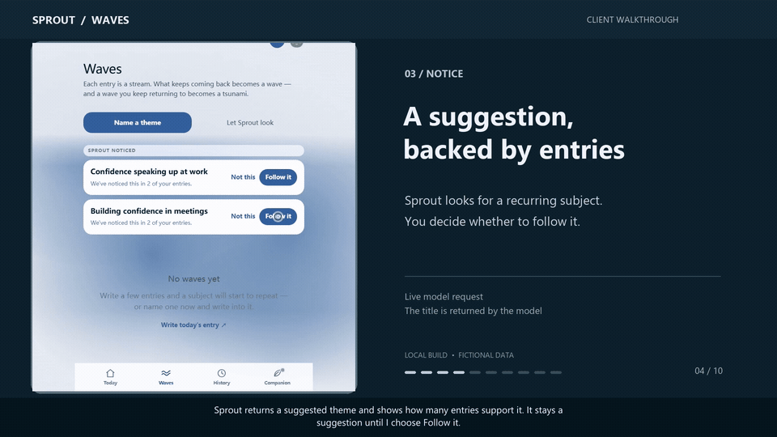

# AI Product Demo Video

**Turn a working app into a client-ready walkthrough, using real product footage.**

A portable coding-agent skill for inspecting a feature, automating its real browser flow, recording it, adding English narration and synchronized captions, and exporting a 1080p MP4 with reusable scripts.



[Watch the narrated example](docs/media/real-demo.mp4) · [View a frame](docs/media/overview.png) · [Read the skill](SKILL.md)

The example comes from a real local Sprout Waves walkthrough. The application interactions and model result were recorded from the running product. Journal entries are fictional, sample history was prepared, and the narration is synthetic. The repository contains the reusable skill, not the client's application source or credentials.

## Try it with your agent

Download or clone this repository, then give your coding agent this prompt:

> Read `SKILL.md` in this repository. Inspect my working application and create a short English client demo of the feature I specify. Record actual browser interactions, use the real backend for any model-powered behavior, add natural narration and synchronized captions, and export a 1080p MP4. Keep the recording scripts reusable and disclose sample data.

Replace the path with wherever you saved the folder. Any agent with file/shell access and browser automation can follow the skill. Native skill discovery is optional. Use your agent's supported skill installation workflow; see the official [Codex](https://learn.chatgpt.com/docs/build-skills) and [Claude Code](https://code.claude.com/docs/en/skills) guides.

## How it works

1. **Inspect the real feature.** Confirm startup, implementation and model connections before writing the story.
2. **Write and record the walkthrough.** Adapt Playwright actions to the actual UI and verify the visible outcomes.
3. **Add the voice and captions.** Generate or import one audio clip per sentence; measure its duration for caption timing.
4. **Export and review.** Assemble H.264/AAC video at 1920×1080, then check the footage, claims and subtitle readability.


Generative AI helps write the story, narration and automation. It does not invent the product screen or substitute a fabricated model result.

## Reusable helpers

Requirements: Node.js 22+, Python 3.10+, Playwright with a browser, and FFmpeg with H.264, AAC and subtitle support. Narration also needs an authorized TTS service or supplied audio clips. Existing tools can be reused; they do not have to be installed globally.

From this skill repository:

```sh
node scripts/init.mjs --out "/path/to/project/demo-video"
```

In the generated recording project:

```sh
npm install
npx playwright install chromium
```

Adapt `plan.json` and `record.mjs` after inspecting your app. Copy `.env.example` to `.env` and configure a speech model, voice and key, or supply existing audio. Then run:

```sh
node speech.mjs
node record.mjs
python compose.py --project .
```

To import narration instead of making a paid request:

```sh
node speech.mjs --audio-dir "/path/to/audio-clips"
```

Name clips `SCENE-ID-0.mp3`, `SCENE-ID-1.wav`, etc., matching the plan's sentence order. See [the recording contract](references/recording.md). The bundled network helper uses [OpenRouter's speech endpoint](https://openrouter.ai/docs/guides/overview/multimodal/tts); choose a currently available model and voice in your own account. Other TTS services can supply the same per-sentence clips.

Output includes the MP4, English SRT, plain narration and a recording report. Captions follow measured sentence audio, not guessed reading speed. Interactions stay visible; a scene can hold its final frame while narration finishes. The helper does not provide word-level forced alignment.

## What this does not promise

The agent still needs to understand your app and adapt the recording scene; this is not a universal one-click recorder for every interface. Missing model credentials cannot be hidden behind a fake result. Native desktop applications need a genuine screen recorder rather than this browser-only template.

Without audio, `--silent-preview` can export a clearly labeled preview. It is not the requested narrated final. Keep `.env`, auth state, account databases and private logs out of the public delivery. Read [the review checklist](references/review.md) before sharing footage.

Verified here: the original real model-powered client walkthrough, fresh capture through the generalized recorder, narration import, caption generation and 1080p export. No new paid TTS request was made while validating the generalized helper. See [validation notes](docs/validation.md).

Skill code is MIT licensed. Product footage is included as a disclosed workflow example.
