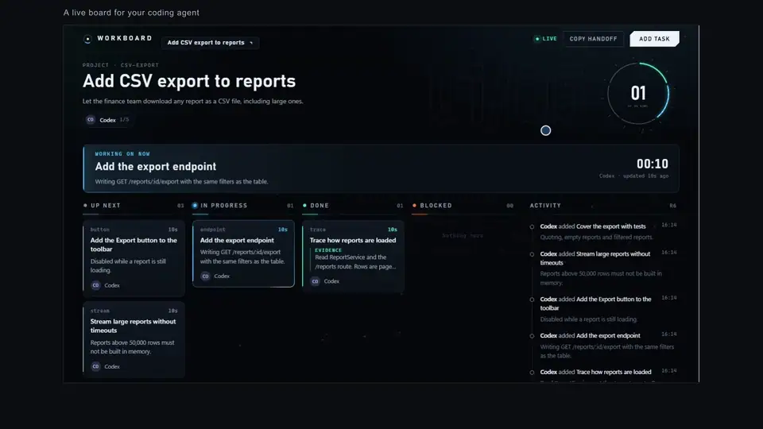

# AI Product Demo Video

**Let your coding agent show the client what you built. It operates the real app, narrates in clear English and hands you a video.**

For the moments in a project when you owe a client an update and a video would do it better than a call:

- **The client is not technical.** They need to watch the feature work, not read a changelog.
- **You would rather not present live.** English may not be your first language, or explaining may not be your strength. The agent writes and voices the narration.
- **You are short on time.** The agent clicks through the feature, records it, adds captions and exports the video while you keep building.


**With narration (30 seconds):**

https://github.com/user-attachments/assets/0556338b-22a5-49c7-a333-05e6e5083b6b

[Download the MP4](docs/media/real-demo.mp4?raw=true) · [View a frame](docs/media/overview.png) · [Read the skill](SKILL.md)

An excerpt from a walkthrough made for the client of Sprout Waves, a journaling app. The agent drove the running product in a browser, including a live request to the app's AI model, and the result on screen is what the model returned. The narration is a synthetic voice. Journal entries are fictional and sample history was prepared. This repository contains the reusable skill, not the client's application source or credentials.

## Try it with your agent

Download or clone this repository, then give your coding agent this prompt:

> Read `SKILL.md` in this repository. Inspect my working application and create a short English client demo of the feature I specify. Record actual browser interactions, use the real backend for any model-powered behavior, add natural narration and synchronized captions, and export a 1080p MP4. Keep the recording scripts reusable and disclose sample data.

Replace the path with wherever you saved the folder. Any agent with file/shell access and browser automation can follow the skill. Native skill discovery is optional. Use your agent's supported skill installation workflow; see the official [Codex](https://learn.chatgpt.com/docs/build-skills) and [Claude Code](https://code.claude.com/docs/en/skills) guides.

## How it works

1. **Inspect the real feature.** Confirm startup, implementation and model connections before writing the story.
2. **Write and record the walkthrough.** Adapt Playwright actions to the actual UI and verify the visible outcomes. A pointer drawn in the page shows where each click lands.
3. **Add the voice and captions.** Generate or import one audio clip per sentence; its measured duration sets the caption timing.
4. **Export and review.** Assemble H.264/AAC video at 1920×1080, then check the footage, claims and subtitle readability.

Generative AI helps write the story, narration and automation. It does not invent the product screen or substitute a fabricated model result. What the client sees is your real product.

## Another example: the default look

The client walkthrough above uses a custom split-screen design. This is what the bundled helpers produce with no design work: the footage framed, a scene title above it, captions below, and a pointer showing each click.



https://github.com/user-attachments/assets/234c8a2b-ff6e-478c-a9eb-b6038a3657e9

[Download the MP4](docs/media/kanban-demo.mp4?raw=true) · [A frame at full size](docs/media/kanban-demo.png)

Recorded by Claude Code from a different running app, a developer tool ([AI Coding Kanban](https://github.com/RJ1107/ai-coding-kanban)). The pointer clicks real controls, and the cards move because real commands reached the app during capture. The plan on the board is a fictional sample, and the narration is a synthetic voice (ElevenLabs Multilingual v2 through OpenRouter).

## Reusable helpers

Requirements: Node.js 22+, Python 3.10+, Playwright with a browser, and FFmpeg with H.264, AAC and subtitle support. Existing tools can be reused; they do not have to be installed globally.

From this skill repository:

```sh
node scripts/init.mjs --out "/path/to/project/demo-video"
```

In the generated recording project:

```sh
npm install
npx playwright install chromium
```

Adapt `plan.json` and `record.mjs` after inspecting your app, choose a narration source, then record and compose:

```sh
node speech.mjs --system-voice
node record.mjs
python compose.py --project .
python preview.py --project . --start 9 --duration 12
```

| Narration source | Command | Notes |
| --- | --- | --- |
| Speech service | `node speech.mjs` | Natural-sounding. Copy `.env.example` to `.env` and set a model, voice and key. A paid request on your account. The bundled helper uses [OpenRouter's speech endpoint](https://openrouter.ai/docs/guides/overview/multimodal/tts) |
| System voice | `node speech.mjs --system-voice [NAME]` | Free and offline, using the voices shipped with Windows, macOS or Linux (`espeak-ng`). More mechanical; good for drafts |
| Your own clips | `node speech.mjs --audio-dir "/path/to/clips"` | Files named `SCENE-ID-0.mp3`, `SCENE-ID-1.wav`, … in sentence order |

Output: the MP4, an English SRT, the plain narration, a recording report, and optionally a short silent animated WebP or GIF for a README. Captions follow measured sentence audio, not guessed reading speed. By default the footage is framed so the scene title and captions sit in the margins and never cover your product; `"layout": "full"` in `plan.json` switches to edge-to-edge footage. Interactions stay visible; a scene can hold its final frame while narration finishes. The helper does not provide word-level forced alignment.

See [the recording contract](references/recording.md) for every option, including tools that are not on PATH.

## What this does not promise

The agent still needs to understand your app and adapt the recording scene; this is not a universal one-click recorder for every interface. Missing model credentials cannot be hidden behind a fake result. Native desktop applications need a genuine screen recorder rather than this browser-only template.

Without audio, `--silent-preview` can export a clearly labeled preview. It is not the requested narrated final. Keep `.env`, auth state, account databases and private logs out of the public delivery. Read [the review checklist](references/review.md) before sharing footage.

Verified here: the original model-powered client walkthrough, made with Codex; and a full run from Claude Code on Windows, shown under "Another example", from a fresh recording project through narration (first with the system voice, then with a speech service), pointer-led recording, captions, 1080p export and the README preview. The assistant measured the audio track but cannot hear it, so pronunciation rests on the owner's review. macOS and Linux have not been run. See [validation notes](docs/validation.md).

Skill code is MIT licensed. Product footage is included as a disclosed workflow example.
